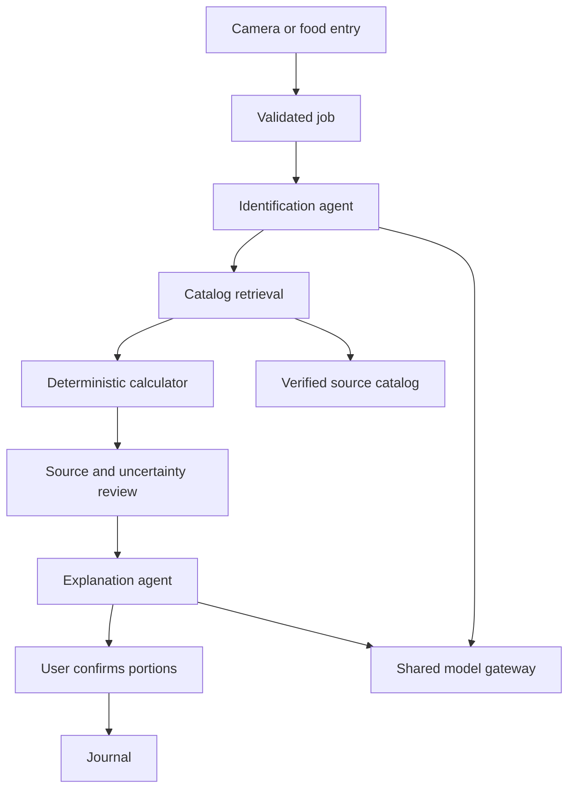

# Architecture and execution contract

## Runtime boundaries

The React app talks to a `WorkspaceApi` interface. `DemoApi` implements the same interface with IndexedDB and explicitly illustrative data. `LiveApi` sends authenticated requests to FastAPI. Neither browser adapter loads model weights. Three.js is a visual interface feature, not a food recognition system.

The API validates requests, stores a durable job, and submits it to a bounded in-process queue. One worker executes five role objects. A separate bounded model gateway serializes analysis and chat calls through the same model provider. SQLite is the persistence layer; model tensors stay in the process and are lazy-loaded once.

## Specialist roles

| Role | Allowed inputs | Output | Authority |
|---|---|---|---|
| Identification | User choices, description, optional supported image | Candidate food names | Proposes identity; cannot establish exact nutrients or weight |
| Retrieval | Candidate names and catalog | Source matches, initial portions | Reads catalog; cannot execute tools from model text |
| Calculation | Source values and selected grams | Totals, ranges, source coverage | Deterministic arithmetic; no LLM required |
| Review | Calculated portions and confirmation state | Flags and missing information | Identifies assumptions and incomplete data |
| Explanation | Bounded evidence JSON | Final readable summary | Uses one model call; cannot modify calculated totals |

This is a bounded multi-agent workflow, not an autonomous internet-browsing agent swarm. Roles have fixed order, bounded messages, and no ability to install software, execute generated code, transfer files externally, or initiate arbitrary tools. Source lookup is lexical matching over an operator-curated catalog, not an embedding database. All roles are ordinary testable classes.

## Job state machine

Jobs move from queued to running, then complete, failed, or cancelled. Terminal states cannot be overwritten by a late generation callback. Each event gets a monotonic SQLite sequence number. SSE clients can replay after `Last-Event-ID`; the frontend also polls as a bounded recovery path when streaming is unavailable.

At startup, interrupted queued/running records are marked failed with an explicit restart message. They are not silently rerun. An idempotency key is scoped to an owner and exact normalized request: retries return the existing job; a different request with the same key conflicts. Requests are not deduplicated by image hashes because portions, user intent, and preparation can change.

Cancellation signals the model's stopping criteria. A cancelled asyncio caller holds the model gateway until the background generation actually exits. This prevents another job starting while cancelled CUDA kernels still occupy memory. External compatible endpoints may continue computing until their response or timeout; the application cannot guarantee server-side cancellation there.

## Reasoning and transparency

Stored job events describe actual workflow operations and evidence checks. The simple capture screen does not render an agent activity panel. It does not simulate a hidden internal thought transcript. For a checkpoint exposing `enable_thinking`, the operator can opt in and the request can select detailed review. Special-token delimiters are retained until any internal reasoning has been removed. Incomplete thinking never becomes the displayed explanation.

The generation budget includes both internal reasoning tokens and final-answer tokens. A small model may fail to finish. In that case, a deterministic explanation and a visible flag replace the incomplete result. The user still receives valid calculated nutrients if the source/portion stage succeeded.

## Storage

SQLite uses WAL, foreign keys, parameterized queries, bounded list endpoints, and owner predicates. Tables contain sessions, jobs, job events, image metadata, journal entries, preferences, recipes, and minimal audit events. Journal entries store result snapshots: changing the catalog later does not silently rewrite past meals. The catalog version is a content-derived hash.

This version initializes a schema at application startup and records its schema version. It does not implement a general upgrade migration engine; back up and add explicit migration scripts before changing table layouts. One API process is required because queues, cancellation events, rate limits, and the shared model are process-local.

## Rendering and interaction

Only the optional About illustration lazy-loads Three.js. Camera/results do not import it. It creates an instanced procedural scene and renders on resize, visibility changes, or bounded pointer movement. It has no permanent animation loop. Pointer motion respects both the app preference and the operating system's reduced-motion setting. GPU resources are disposed on unmount; camera tracks are stopped on hidden/unmount transitions.

Camera frames are user-triggered. Accepted images are validated and re-encoded by the backend, which removes EXIF metadata and bounds decoded dimensions. Browsers may return lower resolutions than requested. The camera hook records negotiated resolution; it does not promise a fixed resolution for every device. The capture screen is intentionally limited to camera controls.

## Extending the project

Add a model provider by implementing the protocol in `inference/contracts.py` and selecting it in the factory. Keep generation behind the shared gateway. Add nutrient fields only after updating Python and TypeScript contracts, catalog normalization, calculations, export headers, and missing-value tests. Add a source importer by producing validated `FoodRecord` values with explicit per-100-g basis and provenance.

Persistent multi-turn LLM conversation memory, distributed agents, mobile native apps, training/fine-tuning, barcode databases, medical personalization, and third-party identity providers are not implemented. The current chat endpoint accepts only fixed food FAQ phrases against a required owned analysis; journal and recipe history are persistent.

## v2 account and input boundaries

A private atomic registry holds up to three scrypt-hashed accounts. Requests resolve their stable owner ID and reject sessions older than the account update timestamp. The existing SQLite schema and owner predicates are retained. The first migrated account may inherit `local-owner`; later accounts use fresh IDs. The queue admits one pending job per account, with one shared model gateway.

Photo observations require an explicit food boolean, confidence floor, structured candidates and an exact unambiguous catalog match. Weights from the model are discarded. Calculation begins at 100 g per food and saving requires confirmed selections. Free-text food entries are exact-name lookups, not LLM prompts. General questions are rejected by a fixed allowlist before any model invocation. A normal scan omits the second explanatory LLM call; advanced API clients can request a bounded detailed explanation. See `PATCH_V2.md` for the limits of model self-reported confidence.
